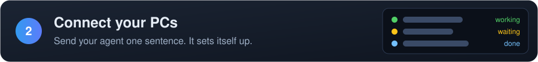

## Get started

<div><pre><a href="https://github.com/esiege/agent-manager-delux/blob/main/deploy.md"></a>
<a href="https://github.com/esiege/agent-manager-delux#get-started"><picture><source media="(prefers-color-scheme: light)" srcset="assets/tab-cloud-off-light.svg"></picture></a><picture><source media="(prefers-color-scheme: light)" srcset="assets/tab-this-pc-on-light.svg"></picture>
<div>

```text
Read https://raw.githubusercontent.com/esiege/agent-manager-delux/main/deploy.md
and set up Agent Manager Delux to run on this PC from this folder.
```

</div></pre></div>

<div><pre><a href="https://github.com/esiege/agent-manager-delux/blob/main/web/public/instructions.md"></a>
<a href="https://github.com/esiege/agent-manager-delux/blob/main/web/public/instructions.md"></a></pre></div>

[Back to the README](https://github.com/esiege/agent-manager-delux#get-started)
